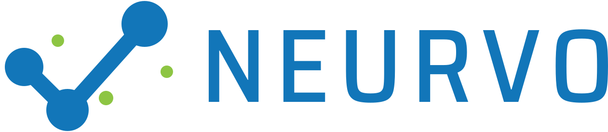
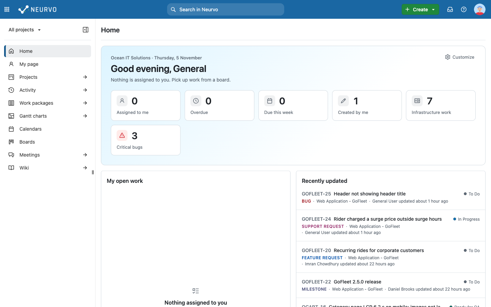
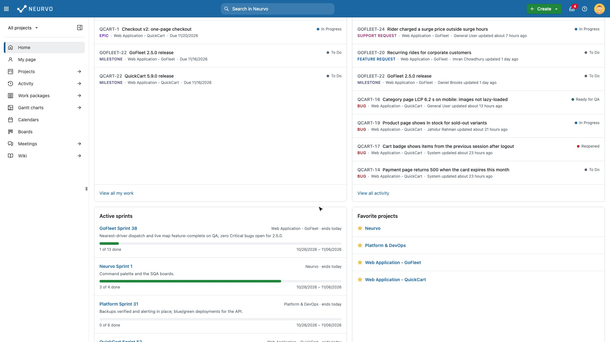
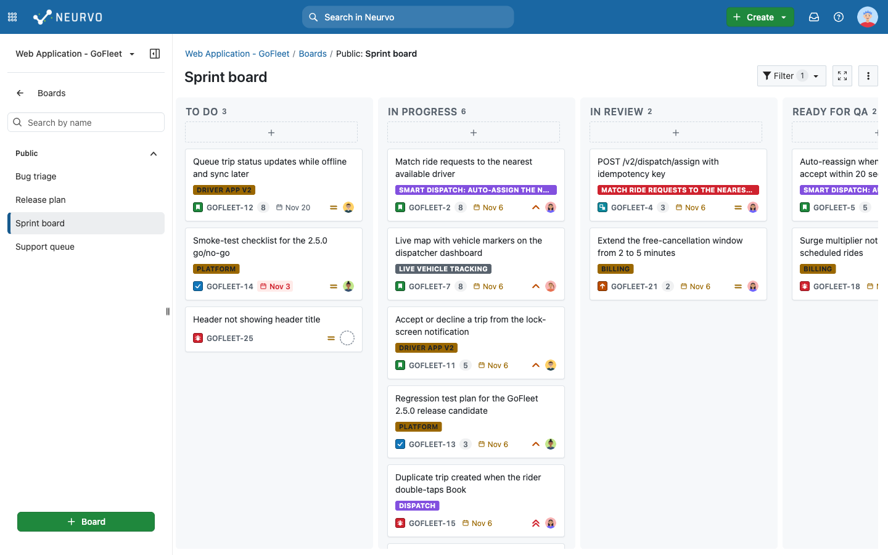
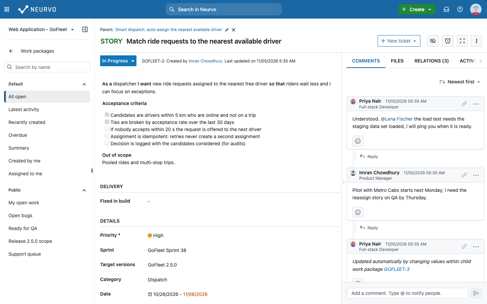
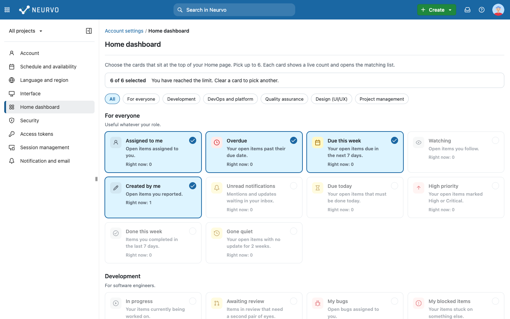
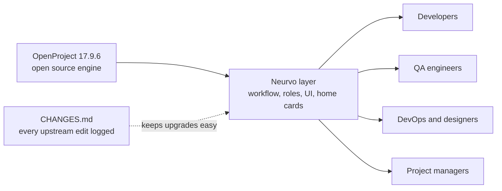

<p align="center">
  
</p>

# Neurvo

**The taste of Jira, for free.** A project and issue tracker for software, QA and DevOps teams, built on the open source [OpenProject](https://www.openproject.org) and reshaped so a dev team can use it on day one.

> Neurvo is a personal project. I took a real open source tool and reshaped it for software, QA and DevOps teams, working inside a large existing codebase and keeping every change documented and easy to upgrade. The screenshots use sample data: **Ocean IT Solutions** and every person in it are fictional.



**Want to try it?** Jump to [Run Neurvo on your computer](#run-neurvo-on-your-computer-docker). It takes seven steps and needs only Docker.

## Watch the demo

[](https://jhrahman.github.io/neurvo/)

**[Click the picture to play it in your browser](https://jhrahman.github.io/neurvo/)** (3 minutes, 1080p, 60 fps, with chapter buttons). Prefer a file? [Download the WebM](docs/neurvo/demo/neurvo-demo.webm).

What you will see, in order: signing in, the role-based Home page, switching between light and dark themes with a colour profile for each, the account settings, the project overview, three boards (Bug triage, Sprint board, Support queue) with issues dragged between statuses, a new task with a comment, a new bug with an @mention, a commenter's profile card, and signing out.

## The problem I wanted to solve

Many teams reach for Jira. The free, self-hosted alternatives are usually either too basic or too generic. OpenProject is powerful and open source, but it is built for *every* kind of project. A software team opening it for the first time faces a blank slate: no bug workflow, no sprint board that feels familiar, a home page that means nothing to a tester, and menus full of features nobody asked for.

So I asked a simple question: **what if a developer, a tester and a DevOps engineer could open the tool and feel at home immediately, without a week of configuration?**

## What I did about it

I took OpenProject (v17.9.6) as the engine and built a Neurvo layer on top:

1. **Made it work out of the box** for a dev and QA team: the right issue types, a real bug lifecycle, readable keys like `GOFLEET-15`, Jira-style boards.
2. **Made it personal**: the Home page shows cards that fit the person's role, and each person can change them.
3. **Made it pleasant**: a calmer UI, a better comment experience, a modern editor, dark mode, and friendly error messages.
4. **Kept it upgradable**: every change to upstream code is logged, so new OpenProject releases can still be merged.

## How Neurvo is better than OpenProject

| | OpenProject out of the box | Neurvo |
|---|---|---|
| **First impression** | A generic project tool | A Jira-style home, boards and issue keys |
| **Workflow** | You design it yourself | Ready on day one: To Do, In Progress, In Review, Ready for QA, In QA, Done, plus a QA gate |
| **Home page** | The same for everyone | **42 cards** that adapt to your role (developer, QA, DevOps, designer, project manager) and that you can customise |
| **Talking on an issue** | One mixed activity feed | A dedicated **Comments** tab with threads, replies, copyable deep links and a highlight on the exact comment |
| **Writing** | Standard editor | Modern editor with real code blocks, a language picker and a copy button |
| **People** | Initials in a circle | Preset avatars, job titles, click-through profile cards, **Reporter** and **Assignee Pair** fields |
| **Errors** | A raw technical toast in the corner | A clear message in the page: what happened, why, and a **Go back** button |
| **Premium upsells** | Banners everywhere | Hidden, nothing unlocked or bypassed |
| **Getting started** | An empty workspace | A fictional sample company with four projects, 15 sample people, boards, sprints, wiki and meetings |

## See it

**Boards your team already knows how to read.** Type badges, issue keys, story points, due dates, priority and assignee on every card.



**Conversations that are easy to follow.** Comments come first, with the author's job title, threaded replies and a link you can copy for any comment.



**A home page that knows who you are.** Pick up to six of 42 cards, grouped by department, with a live count on each one. QA sees test work, DevOps sees infrastructure and changes, designers see UI work, managers see the team.



## Highlights, in plain words

<details>
<summary><b>Role-based home cards</b></summary>

<br>

- 42 cards in six groups: everyone, development, DevOps and platform, QA, design (UI/UX) and project management.
- Each person gets sensible defaults from their project roles. A QA engineer sees *Ready for QA* and *Open bugs*. A developer sees *In progress* and *My bugs*. A manager sees *Team overdue* and *Active sprints*.
- Anyone can change their cards in *Account settings*, with filter chips, live counts, a six-card limit and a reset button.
- Every card opens the matching list, already filtered.

</details>

<details>
<summary><b>A Comments tab built for conversation</b></summary>

<br>

- Comments is the first tab, then Files, Relations and Activity.
- Threaded replies, edit and delete, sort by newest or oldest.
- Copy a link to any comment. Whoever opens it lands on that comment, and it flashes briefly so the eye finds it.
- Click a name or avatar to open a profile card with their job title.

</details>

<details>
<summary><b>Everything a dev and QA team needs, preconfigured</b></summary>

<br>

- Types: Epic, Story, Task, Sub-task, Bug, Feature Request, Change Request, Support Request, Milestone.
- Statuses: To Do, In Progress, In Review, Ready for QA, In QA, Done, plus Reopened, Blocked, Waiting on Customer and Won't Do.
- Bug fields (severity, environment, platform, build), description templates, and a quality gate so only the right roles can mark work as tested or done.
- Six ready-made roles with sensible permissions. See [ROLES.md](docs/neurvo/ROLES.md).

</details>

<details>
<summary><b>Polish that makes daily use nicer</b></summary>

<br>

- Light and dark modes with extra colour palettes. Hover a swatch to see its name.
- A header that works on phones, in-app confirmation dialogs instead of browser pop-ups, and toasts that clear themselves.
- 32 preset avatars to choose from, or upload your own.
- A clear "New issue" button inside a project, so it is never confused with the global "Create".
- A friendly error panel when a list cannot be loaded, with a way back.

</details>

<details>
<summary><b>Fields you control, per issue type</b></summary>

<br>

- **Administration > Issues > Issue fields** shows one issue type at a time. Pick Story, Bug or any other type and tick the fields it should show, default and custom.
- Search the list as you type, enable or disable a whole group, or copy the fields from another type when you add a new one.
- Custom fields can be created and edited from the same page.

</details>

<details>
<summary><b>Assign to me, like Jira</b></summary>

<br>

- Under Assignee, Accountable and Assignee Pair there is an **Assign to me** link, on every issue type.
- On an existing issue it assigns you and saves at once. On the new-issue form it fills the field for you.

</details>

<details>
<summary><b>Easier user administration</b></summary>

<br>

- A gear icon beside every username opens that person's settings: name, email and more.
- A row menu offers **Edit user**, **Send password reset** and **Lock or unlock**.
- The user list has an always-open search bar that filters as you type.

</details>

<details>
<summary><b>Built to stay maintainable</b></summary>

<br>

- Neurvo is a fork, so I treated upgrades as a feature. Every change to an upstream file is listed with a one-line reason in [CHANGES.md](docs/neurvo/CHANGES.md).
- Only user-facing text says "Neurvo". Internal names stay as they are, so merges stay clean.
- Settings and seed data come first, code changes last, and small commits throughout.

</details>

## How it fits together



**Built with:** Ruby on Rails 8, PostgreSQL, Hotwire (Turbo and Stimulus), TypeScript, Angular (legacy parts), the Primer design system, CKEditor 5, and Docker Compose with Caddy for production.

## How it was built

I built Neurvo on my own, working with an AI coding assistant (Claude Code) as a pair programmer. I decided what to build and why, reviewed the result in a real browser, and kept the project upgradable and documented. Changes were checked in the running app. The upstream OpenProject test suite is included in `spec/`.

---

## Your data stays on your server

Neurvo is built to be hosted by a private organization on its own server. Issues, comments, files, accounts and backups live in the PostgreSQL database and storage of the machine you run it on. **There is no tracker in Neurvo, and nothing is sent to OpenProject or to any other third party.**

*Last reviewed in November 2026, on Neurvo built from OpenProject 17.9.6.*

### What does not leave your server

- **No telemetry, no usage statistics, no update check.** The code contains none. Enterprise tokens are checked locally, with no call to a license server.
- **No analytics, session recording, chat widgets, ads or third-party scripts.** There are no fonts or scripts from a CDN either. Every page loads only from your own server.
- **No Gravatar.** Email address hashes are never sent to gravatar.com. People pick one of 32 built-in avatars or upload a picture.
- **No error reporting to a vendor.** The AppSignal, Airbrake and OpenTelemetry integrations ship switched off and stay silent unless an administrator sets them up on purpose.
- **No "security badge".** The upstream badge that reports your instance ID and version to OpenProject is off.
- **No AI provider.** Neurvo has none built in. The MCP server (an inbound API for outside AI tools) is off by default and needs an administrator to turn it on.
- **Links are only links.** Help and documentation links to openproject.org, YouTube and so on send nothing until someone clicks them. The production setup also hides the Enterprise banners and the trial form, which is the one upstream feature that would contact OpenProject, and only when an administrator submits it.

Neurvo talks to other systems only when an administrator connects them: your mail server, LDAP or single sign-on, GitHub or GitLab, webhooks and file storages such as Nextcloud. By design, the production stack makes two other kinds of outbound requests: the Caddy proxy asks Let's Encrypt for your free HTTPS certificate, and Docker pulls images when you install or update.

### How this was checked

- **Code review** for every outbound call, tracker and third-party script, in the core code and in all 30 bundled modules.
- **Live network monitoring.** The backend and the background worker were watched for about five minutes while every scheduled job ran once and 30 pages were opened in a browser, including every administration page. Neither container made a single connection to a public address, and the browser only ever talked to the Neurvo server. A deliberate test connection was caught by the same monitor, so an empty result can be trusted.

You can check it yourself: open your browser's developer tools, switch to the **Network** tab, and use Neurvo. Every request goes to your own host. For a hard guarantee, block outbound traffic from the server in your firewall (keep Let's Encrypt and your mail server if you use them). Neurvo works without internet access.

### Security

- **Sign-in is required.** Nothing is visible to anonymous visitors, and the API answers 401 without a login.
- **Strong defaults.** Passwords need at least 10 characters. An account is locked for 30 minutes after 10 failed sign-ins. Session cookies are `HttpOnly`, `SameSite=Lax` and `Secure` over HTTPS. Forms are protected against CSRF.
- **Strict browser policy.** A tight Content-Security-Policy, `X-Frame-Options`, `nosniff` and a referrer policy are sent on every page. Outgoing webhooks are protected against requests to internal addresses (SSRF).
- **No default credentials in production.** The stack refuses to start without your own administrator email and password and a long random `SECRET_KEY_BASE`, and it rejects the `admin`, `change-me` and weak-secret placeholders. The administrator's credentials are visible only to the one-time seeder container.
- **Reviewed and patched.** The review found no critical issue in Neurvo's own code and no committed secrets, and Neurvo's changes removed no permission check. Dependencies were brought to the latest patch releases on 18 November 2026, including Rails 8.1.4.1, Rack 2.2.25 and Nokogiri 1.19.7, which fixed all published advisories at that time except those listed below. The full list of Neurvo's changes to upstream code is in [docs/neurvo/CHANGES.md](docs/neurvo/CHANGES.md).

### Known limits and your part

No software can promise zero vulnerabilities, and Neurvo inherits the strengths and the risks of the OpenProject code it is built on.

- Two server dependencies, `puma` and `dalli`, have advisories whose fixed releases are still inside the project's seven-day supply-chain cooldown. A few advisories remain in front-end build tooling and in the optional BIM viewer, and need releases from their maintainers. These are tracked and will be updated as fixes ship.
- The `/health_checks/` page is reachable without a login and shows the database schema version. On a public server, block it at your reverse proxy.
- Keep it updated: pull new images, apply upstream OpenProject security releases, and re-run a dependency scan from time to time.
- Use HTTPS (the production stack does this for you), unique passwords for every person, a firewall, and regular backups. The [deployment guide](docs/neurvo/DEPLOY.md) has a checklist.

---

## Run Neurvo on your computer (Docker)

Everything runs in Docker, so you do not install Ruby, Node or PostgreSQL yourself.

### What you need

| | |
|---|---|
| **Docker** | Docker Desktop (Mac or Windows) or Docker Engine with Compose (Linux) |
| **Memory** | 8 GB given to Docker (10 to 12 GB is more comfortable) |
| **Disk** | About 20 GB free |
| **Other** | Git. Apple Silicon Macs work. On Windows use WSL 2 |
| **Time** | 15 to 30 minutes for the first setup, one or two minutes for later starts |

### Step by step

**1. Install and start Docker**

- **Mac:** `brew install --cask docker`, open Docker Desktop, then set *Settings > Resources > Memory* to 8 GB or more.
- **Windows:** install Docker Desktop with the **WSL 2** backend and [WSL](https://learn.microsoft.com/windows/wsl/install) (`wsl --install` in an admin PowerShell, then restart). In Docker Desktop enable your Ubuntu distro under *Settings > Resources > WSL integration*, and give it 8 GB or more. Do every following step in the **Ubuntu** terminal.
- **Linux:** install Docker Engine and the Compose plugin.

**2. Get the code**

```bash
git clone https://github.com/jhrahman/neurvo.git
cd neurvo
git checkout neurvo
```

On Windows, clone inside the Linux file system (for example `~/neurvo`), not under `/mnt/c`, or everything is very slow.

**3. Prepare Docker, once**

```bash
docker network create gateway
cp docker-compose.override.example.yml docker-compose.override.yml
```

If Docker says the network `gateway` already exists, that is fine. The second command publishes the app on port 3000.

**4. Build and install, once (15 to 30 minutes)**

```bash
bin/compose setup
```

This builds the images, installs the dependencies and sets up the database. Warnings about `DEV_UID` and `DEV_GID` are harmless.

**5. Start Neurvo**

```bash
bin/compose start
bin/compose up -d backend worker
```

**6. Load the sample company (recommended)**

```bash
bin/compose exec backend bundle exec rake neurvo:seed
```

This creates the Neurvo workflow, issue types, fields and roles, plus four fictional projects and a sample team. Skip it if you want an empty workspace. It is safe to run again.

**7. Open the app**

Go to <http://localhost:3000>. The first page can take a few minutes while the frontend compiles. To watch progress, run `bin/compose logs -f backend`.

### Sign in

| Account | Details |
|---|---|
| Administrator | `admin` / `admin`. You are asked to change the password at the first login |
| Sample people | One account per role (developer, QA, DevOps, designer, project manager, team member). Usernames and the seed password are listed in [USERS.md](docs/neurvo/USERS.md) |

Sign in as different people and compare the Home page: the cards change with the role. These accounts are for local use only, so never create them on a real server.

### Everyday commands

| I want to | Run |
|---|---|
| Start Neurvo | `bin/compose start && bin/compose up -d backend worker` |
| Stop it (keeps your data) | `bin/compose stop` |
| See what is running | `bin/compose ps` |
| Follow the logs | `bin/compose logs -f backend` |
| Restart after a settings, menu or language-file change | `bin/compose restart backend` |
| Open a Rails console | `bin/compose exec backend bundle exec rails console` |
| Reload the sample data | `bin/compose exec backend bundle exec rake neurvo:seed` |
| **Delete everything** and start over | `bin/compose reset`, then step 4 again |

### If something goes wrong

| What you see | Fix |
|---|---|
| The page loads but has no styling, or the frontend container stopped | The frontend ran out of memory. Give Docker more memory, then `bin/compose up -d frontend` |
| "Found local `config/database.yml`" | Rename or delete that file. The Docker setup does not work with it |
| Port 3000 is already in use | Stop the other program using it, or change the port in `docker-compose.override.yml` |
| A new menu entry or language change does not show up | `bin/compose restart backend` |
| Very slow on Windows | The code is under `/mnt/c`. Clone it again inside WSL |
| Sample emails never arrive | Dev emails open at <http://localhost:3000/letter_opener> |

More tips, memory settings, running specs safely and sharing your local copy: [DEVELOPMENT.md](docs/neurvo/DEVELOPMENT.md).

## Deploy it on a server

Production runs on one Linux server with Docker Compose and automatic HTTPS. As a rough guide, plan for about 8 GB of memory, 4 CPUs and 40 GB of disk for a team of around 100. This is a sizing estimate, not a measured production figure. You need a domain name pointing at the server and ports 80 and 443 open.

```bash
curl -fsSL https://get.docker.com | sh
git clone https://github.com/jhrahman/neurvo.git && cd neurvo && git checkout neurvo
cp .env.prod.example .env.prod
nano .env.prod                       # your domain, admin email and admin password
./bin/neurvo-prod up -d --build      # 20 to 40 minutes the first time
./bin/neurvo-prod exec web bundle exec rake neurvo:seed CONFIG_ONLY=1
```

Open `https://<your domain>` and sign in as `admin` with the password you chose. The production stack is tuned to be light: one web process, a small cache, rotated logs, and the incoming-email job off by default.

The full step-by-step guide covers installing Docker, creating the secrets, email, backups, updates and troubleshooting: **[DEPLOY.md](docs/neurvo/DEPLOY.md)**. The production stack has been checked with `docker compose config` only, so try it on a test server first.

## Documentation

| Read this | To learn |
|---|---|
| [CHANGES.md](docs/neurvo/CHANGES.md) | Every change to upstream code and why (keeps upgrades easy) |
| [ROLES.md](docs/neurvo/ROLES.md) | Roles, permissions and which Home cards each role gets |
| [DEVELOPMENT.md](docs/neurvo/DEVELOPMENT.md) | Local development, memory tips and what to restart after a change |
| [DEPLOY.md](docs/neurvo/DEPLOY.md) | Production deployment, backups and updates |
| [NEURVO.md](NEURVO.md) | Product vision and the rules I follow |
| [OpenProject user guide](https://www.openproject.org/docs/user-guide/) | Everything Neurvo inherits |

## License and credits

Neurvo is based on [OpenProject](https://www.openproject.org) and, like it, is licensed under the GNU GPL v3. See [COPYRIGHT](COPYRIGHT) and [LICENSE](LICENSE). Many thanks to the OpenProject community, whose work makes this possible.

Created by **Jahidur Rahman**.
