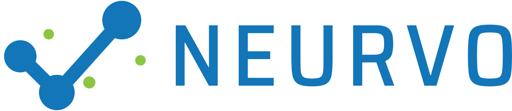
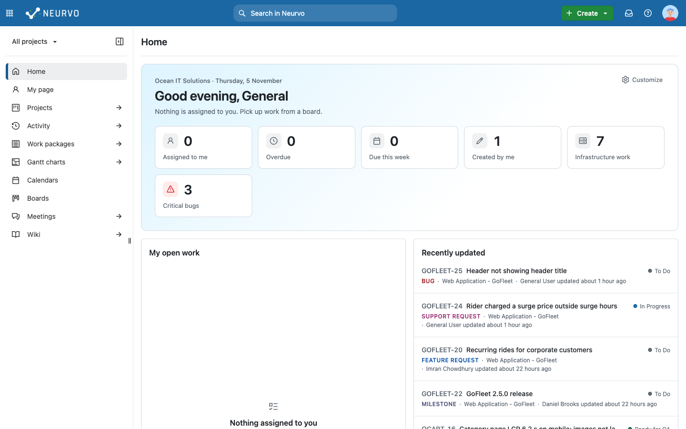
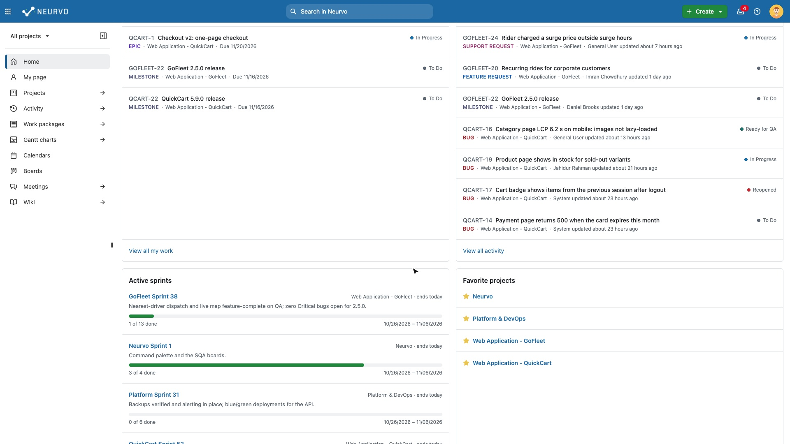
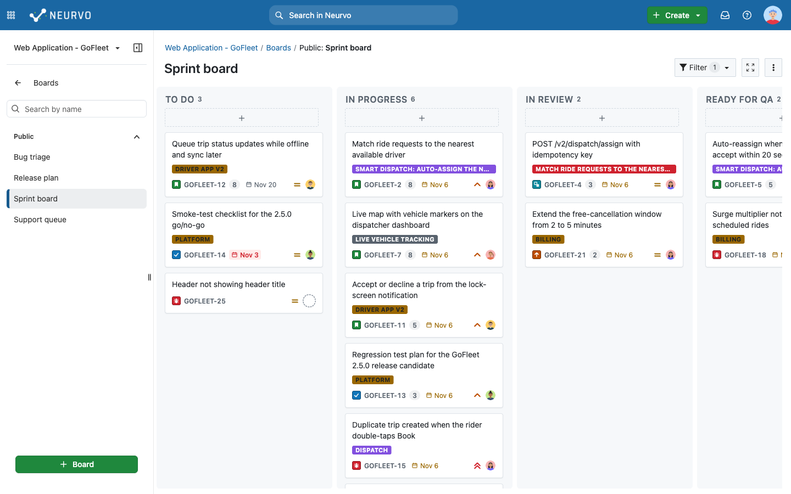
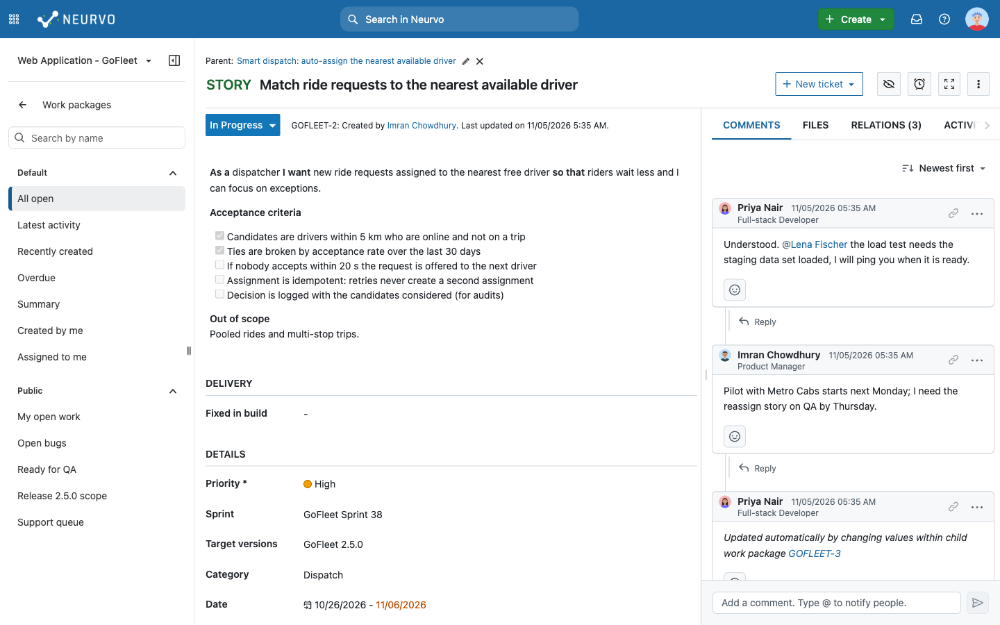
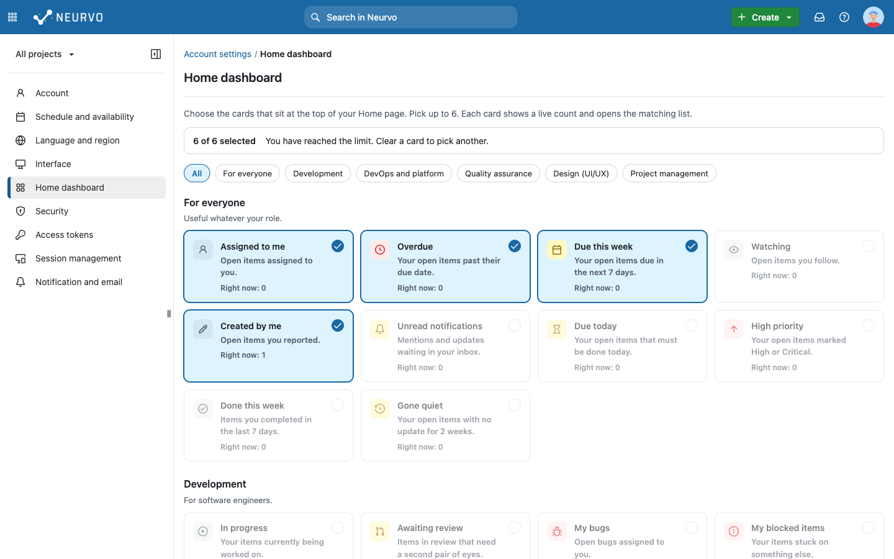
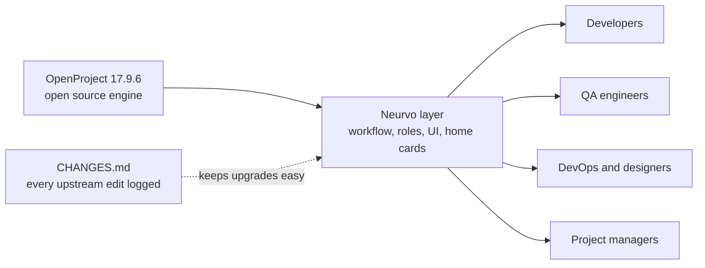

<p align="center">
  
</p>

# Neurvo

**The taste of Jira, for free.** A project and ticket tracker for software, QA and DevOps teams, built on the open source [OpenProject](https://www.openproject.org) and reshaped so a dev team can use it on day one.

> Neurvo is a personal project. I took a real open source tool and reshaped it for software, QA and DevOps teams, working inside a large existing codebase and keeping every change documented and easy to upgrade. The screenshots use sample data: **Ocean IT Solutions** and every person in it are fictional.



## Watch a two-minute tour

[](https://github.com/jhrahman/neurvo/raw/main/docs/neurvo/demo/neurvo-demo.webm)

*Click the picture to play (2 minutes, 1080p, 60 fps).* It covers signing in, the role-based Home cards and how to change them, light and dark themes, the work package list, a ticket with its Reporter and Assignee Pair, the backlog and the boards.

## The problem I wanted to solve

Many teams reach for Jira. The free, self-hosted alternatives are usually either too basic or too generic. OpenProject is powerful and open source, but it is built for *every* kind of project. A software team opening it for the first time faces a blank slate: no bug workflow, no sprint board that feels familiar, a home page that means nothing to a tester, and menus full of features nobody asked for.

So I asked a simple question: **what if a developer, a tester and a DevOps engineer could open the tool and feel at home immediately, without a week of configuration?**

## What I did about it

I took OpenProject (v17.9.6) as the engine and built a Neurvo layer on top:

1. **Made it work out of the box** for a dev and QA team: the right ticket types, a real bug lifecycle, readable keys like `GOFLEET-15`, Jira-style boards.
2. **Made it personal**: the Home page shows cards that fit the person's role, and each person can change them.
3. **Made it pleasant**: a calmer UI, a better comment experience, a modern editor, dark mode, and friendly error messages.
4. **Kept it upgradable**: every change to upstream code is logged, so new OpenProject releases can still be merged.

## How Neurvo is better than OpenProject

| | OpenProject out of the box | Neurvo |
|---|---|---|
| **First impression** | A generic project tool | A Jira-style home, boards and ticket keys |
| **Workflow** | You design it yourself | Ready on day one: To Do, In Progress, In Review, Ready for QA, In QA, Done, plus a QA gate |
| **Home page** | The same for everyone | **42 cards** that adapt to your role (developer, QA, DevOps, designer, project manager) and that you can customise |
| **Talking on a ticket** | One mixed activity feed | A dedicated **Comments** tab with threads, replies, copyable deep links and a highlight on the exact comment |
| **Writing** | Standard editor | Modern editor with real code blocks, a language picker and a copy button |
| **People** | Initials in a circle | Preset avatars, job titles, click-through profile cards, **Reporter** and **Assignee Pair** fields |
| **Errors** | A raw technical toast in the corner | A clear message in the page: what happened, why, and a **Go back** button |
| **Premium upsells** | Banners everywhere | Hidden, nothing unlocked or bypassed |
| **Getting started** | An empty workspace | A fictional sample company with four projects, 15 sample people, boards, sprints, wiki and meetings |

## See it

**Boards your team already knows how to read.** Type badges, issue keys, story points, due dates, priority and assignee on every card.



**Conversations that are easy to follow.** Comments come first, with the author's job title, threaded replies and a link you can copy for any comment.



**A home page that knows who you are.** Pick up to six of 42 cards, grouped by department, with a live count on each one. QA sees test work, DevOps sees infrastructure and changes, designers see UI work, managers see the team.



## Highlights, in plain words

<details>
<summary><b>Role-based home cards</b></summary>

<br>

- 42 cards in six groups: everyone, development, DevOps and platform, QA, design (UI/UX) and project management.
- Each person gets sensible defaults from their project roles. A QA engineer sees *Ready for QA* and *Open bugs*. A developer sees *In progress* and *My bugs*. A manager sees *Team overdue* and *Active sprints*.
- Anyone can change their cards in *Account settings*, with filter chips, live counts, a six-card limit and a reset button.
- Every card opens the matching list, already filtered.

</details>

<details>
<summary><b>A Comments tab built for conversation</b></summary>

<br>

- Comments is the first tab, then Files, Relations and Activity.
- Threaded replies, edit and delete, sort by newest or oldest.
- Copy a link to any comment. Whoever opens it lands on that comment, and it flashes briefly so the eye finds it.
- Click a name or avatar to open a profile card with their job title.

</details>

<details>
<summary><b>Everything a dev and QA team needs, preconfigured</b></summary>

<br>

- Types: Epic, Story, Task, Sub-task, Bug, Feature Request, Change Request, Support Request, Milestone.
- Statuses: To Do, In Progress, In Review, Ready for QA, In QA, Done, plus Reopened, Blocked, Waiting on Customer and Won't Do.
- Bug fields (severity, environment, platform, build), description templates, and a quality gate so only the right roles can mark work as tested or done.
- Six ready-made roles with sensible permissions. See [ROLES.md](docs/neurvo/ROLES.md).

</details>

<details>
<summary><b>Polish that makes daily use nicer</b></summary>

<br>

- Light and dark modes with extra colour palettes. Hover a swatch to see its name.
- A header that works on phones, in-app confirmation dialogs instead of browser pop-ups, and toasts that clear themselves.
- 32 preset avatars to choose from, or upload your own.
- A clear "New ticket" button inside a project, so it is never confused with the global "Create".
- A friendly error panel when a list cannot be loaded, with a way back.

</details>

<details>
<summary><b>Built to stay maintainable</b></summary>

<br>

- Neurvo is a fork, so I treated upgrades as a feature. Every change to an upstream file is listed with a one-line reason in [CHANGES.md](docs/neurvo/CHANGES.md).
- Only user-facing text says "Neurvo". Internal names stay as they are, so merges stay clean.
- Settings and seed data come first, code changes last, and small commits throughout.

</details>

## How it fits together



**Built with:** Ruby on Rails 8, PostgreSQL, Hotwire (Turbo and Stimulus), TypeScript, Angular (legacy parts), the Primer design system, CKEditor 5, and Docker Compose with Caddy for production.

## How it was built

I built Neurvo on my own, working with an AI coding assistant (Claude Code) as a pair programmer. I decided what to build and why, reviewed the result in a real browser, and kept the project upgradable and documented. Changes were checked in the running app. The upstream OpenProject test suite is included in `spec/`.

---

## Try it on your computer

You need **Docker Desktop** with about 8 GB of memory (10 to 12 GB is more comfortable), 20 GB of free disk and Git. The first setup takes 15 to 30 minutes, and later starts take a minute or two.

### 1. Get the code

**Mac**

```bash
brew install --cask docker        # then open Docker Desktop and give it 8 GB or more
git clone https://github.com/jhrahman/neurvo.git neurvo && cd neurvo
git checkout neurvo
```

**Windows**

1. Install [Docker Desktop](https://www.docker.com/products/docker-desktop/) with the **WSL 2** backend, and [WSL](https://learn.microsoft.com/windows/wsl/install) (`wsl --install` in an admin PowerShell, then restart).
2. In Docker Desktop, enable your Ubuntu distro under Settings > Resources > WSL integration, and give it 8 GB or more.
3. Open the **Ubuntu** terminal and clone **inside the Linux file system** (for example `~/neurvo`), not under `/mnt/c`, or everything will be very slow.

### 2. Start it (same on both)

```bash
docker network create gateway
cp docker-compose.override.example.yml docker-compose.override.yml
bin/compose setup                  # builds, installs, migrates (15 to 30 minutes, once)
bin/compose start
bin/compose up -d backend worker
bin/compose exec backend bundle exec rake neurvo:seed    # the sample company (recommended)
```

Open <http://localhost:3000>.

### 3. Sign in

The administrator account is `admin` and you are asked to change its password at the first login. The sample seed also creates one account per role (developer, QA, DevOps, designer, project manager and a general team member). Their usernames and the seed password are in `lib/neurvo/seed_data.yml` and `lib/neurvo/seed.rb`.

Sign in as different people and compare the Home page: the cards change with the role.

**Daily use:** `bin/compose start && bin/compose up -d backend worker` to start, `bin/compose stop` to stop. If a page looks unstyled, the frontend ran out of memory: `bin/compose up -d frontend`. More tips, memory settings and sharing a local copy: [DEVELOPMENT.md](docs/neurvo/DEVELOPMENT.md).

## Deploy it on a server

Production runs on one Linux server with Docker Compose and automatic HTTPS. As a rough guide, plan for about 8 GB of memory, 4 CPUs and 40 GB of disk for a team of around 100. This is a sizing estimate, not a measured production figure.

```bash
curl -fsSL https://get.docker.com | sh
git clone https://github.com/jhrahman/neurvo.git neurvo && cd neurvo
cp .env.prod.example .env.prod && nano .env.prod     # host name, database password, secret key
docker compose --env-file .env.prod -f docker-compose.prod.yml up -d --build
```

Open `https://<your host>`, sign in as `admin` / `admin` and change the password straight away. The full guide covers what to set up next, the Neurvo workflow without sample data, backups and updates: [DEPLOY.md](docs/neurvo/DEPLOY.md).

## Documentation

| Read this | To learn |
|---|---|
| [CHANGES.md](docs/neurvo/CHANGES.md) | Every change to upstream code and why (keeps upgrades easy) |
| [ROLES.md](docs/neurvo/ROLES.md) | Roles, permissions and which Home cards each role gets |
| [DEVELOPMENT.md](docs/neurvo/DEVELOPMENT.md) | Local development, memory tips and what to restart after a change |
| [DEPLOY.md](docs/neurvo/DEPLOY.md) | Production deployment, backups and updates |
| [NEURVO.md](NEURVO.md) | Product vision and the rules I follow |
| [OpenProject user guide](https://www.openproject.org/docs/user-guide/) | Everything Neurvo inherits |

## License and credits

Neurvo is based on [OpenProject](https://www.openproject.org) and, like it, is licensed under the GNU GPL v3. See [COPYRIGHT](COPYRIGHT) and [LICENSE](LICENSE). Many thanks to the OpenProject community, whose work makes this possible.

Created by **Jahidur Rahman**.
