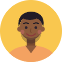

# Sample users

Development and demo accounts, all fictional (the people and "Ocean IT Solutions" are made up), created by `bin/compose exec backend bundle exec rake neurvo:seed`.
Sign in at <http://localhost:3000>. **Change or delete these before any real use**: the passwords are public.
The `admin` and `general.user` passwords above were set on the dev instance; a fresh `neurvo:seed` on a new database creates `general.user` with `Neurvo-Dev-2026!` and `admin` with the OpenProject default.
What each role may do is described in [ROLES.md](ROLES.md).

| Avatar | Name | Username | Password | Job title | Role | Projects |
|:-:|---|---|---|---|---|---|
|  | Jahidur Rahman | `admin` | `<redacted>` | Senior Engineer | Administrator | all |
|  | Imran Chowdhury | `imran.chowdhury` | `Neurvo-Dev-2026!` | Product Manager | Project Manager | GoFleet |
|  | Ayesha Karim | `ayesha.karim` | `Neurvo-Dev-2026!` | Product Manager | Project Manager | QuickCart, Neurvo |
|  | Daniel Brooks | `daniel.brooks` | `Neurvo-Dev-2026!` | Tech Lead | Project Manager | all four |
|  | Rafi Hasan | `rafi.hasan` | `Neurvo-Dev-2026!` | Backend Developer | Developer | QuickCart, Platform & DevOps |
|  | Sofia Martins | `sofia.martins` | `Neurvo-Dev-2026!` | Frontend Developer | Developer | GoFleet, Neurvo |
|  | Arif Rahman | `arif.rahman` | `Neurvo-Dev-2026!` | Frontend Developer | Developer | QuickCart |
|  | Kenji Watanabe | `kenji.watanabe` | `Neurvo-Dev-2026!` | Mobile Developer | Developer | GoFleet |
|  | Priya Nair | `priya.nair` | `Neurvo-Dev-2026!` | Full-stack Developer | Developer | GoFleet, Platform & DevOps, Neurvo |
|  | Nusrat Jahan | `nusrat.jahan` | `Neurvo-Dev-2026!` | QA Lead | QA Engineer | all four |
|  | Marco Rossi | `marco.rossi` | `Neurvo-Dev-2026!` | QA Automation Engineer | QA Engineer | QuickCart |
|  | Lena Fischer | `lena.fischer` | `Neurvo-Dev-2026!` | QA Engineer | QA Engineer | GoFleet |
|  | Maya Patel | `maya.patel` | `Neurvo-Dev-2026!` | UX Designer | Designer | GoFleet, QuickCart |
|  | Tanvir Ahmed | `tanvir.ahmed` | `Neurvo-Dev-2026!` | DevOps Engineer | DevOps Engineer | all four |
|  | General User | `general.user` | `<redacted>` | Team Member | Team Member | all four |

Every account above has one of the preset avatars pre-selected. Anyone can pick a different one (or upload a photo) under
*My account > Avatar > Or choose one of our avatars*; an administrator can do the same for any user from the user's edit page.
The 32 presets are described in [lib/neurvo/avatars/README.md](../../lib/neurvo/avatars/README.md).

Projects: GoFleet = Web Application - GoFleet, QuickCart = Web Application - QuickCart, Platform & DevOps, Neurvo.
Email addresses are `<username>@oceanit.example` (test addresses; the dev stack delivers mail to the in-app letter opener only).

## One account per role to start with

| Role | Username |
|---|---|
| Project Manager | `imran.chowdhury` |
| Developer | `sofia.martins` |
| QA Engineer | `lena.fischer` |
| DevOps Engineer | `tanvir.ahmed` |
| Designer | `maya.patel` |
| Team Member (general user, every project) | `general.user` |

## General user

`general.user` is a normal, non-administrator account that is a member of all four projects with the **Team Member**
role. Like a regular Jira user it can view everything in those projects and create, edit, comment on and delete work
packages, run boards and sprints, edit the wiki and documents, manage meetings and save public views, and it can edit
its own profile under *My account*. It cannot change project settings, members, types, workflows, modules or any
system administration setting, and it is not bound by the QA quality gate.
